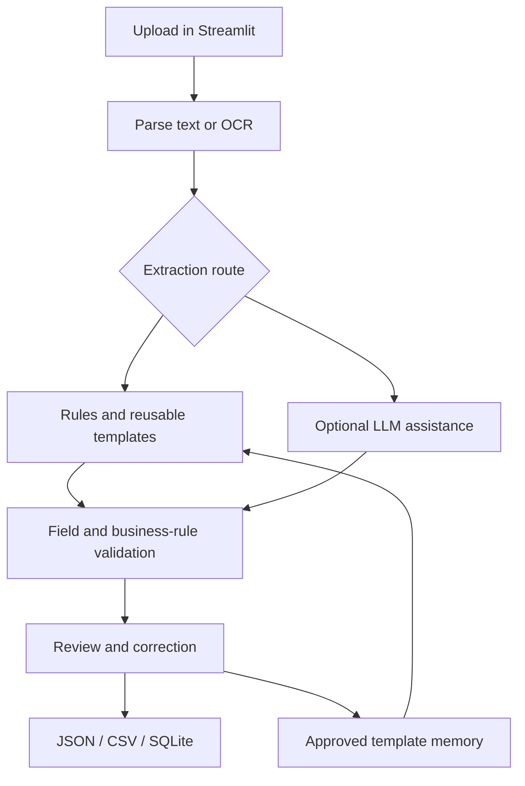

# AiOcr | Document Intelligence & Data Quality

Turn business documents into structured records, validate their quality, and let a reviewer correct uncertain results.

**Team capstone project, with portfolio additions by Shashwat Mishra.** Original team repository: [cjm010/AiOcr](https://github.com/cjm010/AiOcr). Original implementation and contributor history belong to the team; this version does not claim sole authorship of the application.

[My contribution](docs/MY_CONTRIBUTION.md) · [Architecture](docs/ARCHITECTURE.md) · [Demo](docs/DEMO.md) · [Benchmark](docs/BENCHMARK.md) · [Full technical guide](docs/TECHNICAL_GUIDE.md)

## Business problem

Inconsistent document layouts make data entry difficult. Downstream users need complete fields, consistent totals, duplicate detection, review workflows, and traceable outputs.

AiOcr combines local rules, reusable templates, optional LLM assistance, validation, and human review. The team prototype includes invoices, NDAs, discharge summaries, lab reports, and business documents. The portfolio benchmark focuses on invoices.

## My contribution

I contributed across solution architecture, extraction/OCR, validation, database integration, the Streamlit interface, testing, and documentation as part of the project team. These were shared responsibilities rather than exclusive ownership of every module.

This branch adds seven labeled synthetic invoices, an isolated local benchmark, scoring tests, and portfolio documentation, prepared with AI coding assistance. See [contribution details](docs/MY_CONTRIBUTION.md).

## Architecture



## Try it without an API key

Use Python 3.11 or 3.12. From the repository root:

```bash
python -m venv .venv
# macOS / Linux
source .venv/bin/activate
# Windows PowerShell: .venv\Scripts\Activate.ps1
python -m pip install -r requirements-test.txt
python -m streamlit run app.py
```

Choose **rule-based** extraction and upload `examples/benchmark/standard.txt`. Text examples require no OCR packages or model credentials. For PDF/OCR and optional LLM functionality, follow the [full setup guide](docs/TECHNICAL_GUIDE.md#quick-start).

## Reproduce the benchmark

```bash
python scripts/benchmark_extraction.py --mode rule-based --repeats 3 --output benchmark-results/rule-based.json
python scripts/benchmark_extraction.py --mode adaptive-local --repeats 3 --output benchmark-results/adaptive-local.json
python -m pytest tests/test_benchmark.py -v
```

The benchmark checks eight scalar fields against explicit labels, records pipeline timing and validation failures, and uses fresh temporary storage for every document and repeat. It disables learning and never calls a model API. Unfamiliar-layout challenge cases remain in the results even when fields are missed.

See [methodology and measured results](docs/BENCHMARK.md). This small synthetic text corpus does not establish OCR quality, general document accuracy, production throughput, or workplace savings.

## Repository map

| Location | Purpose |
|---|---|
| `app.py` | Streamlit upload, review, schema, and dashboard UI |
| `src/doc_ai/` | Parsing, extraction, validation, storage, template memory |
| `examples/benchmark/` | Synthetic invoices and hand-labeled expected values |
| `scripts/benchmark_extraction.py` | Local benchmark runner |
| `tests/` | Existing team tests and benchmark regression tests |
| `docs/` | Architecture, contribution, demo, benchmark, technical guide |

## Tests and development

```bash
python -m pytest tests/ -v
```

The lean dependencies support text processing and unit/UI tests. PDF/OCR dependencies and browser E2E prerequisites are separate; see the technical guide and `tests/test_e2e.py`. The upstream workflow tests Python 3.11 and 3.12. Follow [CONTRIBUTING.md](CONTRIBUTING.md) for contributions back to the team repository.

## Scope and attribution

This is a capstone proof of concept. Template memory reuses reviewed patterns; it does not fine-tune an LLM. Field confidence is heuristic rather than a calibrated probability of correctness. All new public examples are synthetic.

The [original project](https://github.com/cjm010/AiOcr) remains the source of the team implementation. Existing history and credits are retained. Portfolio benchmark results are separate from workplace impact metrics.
